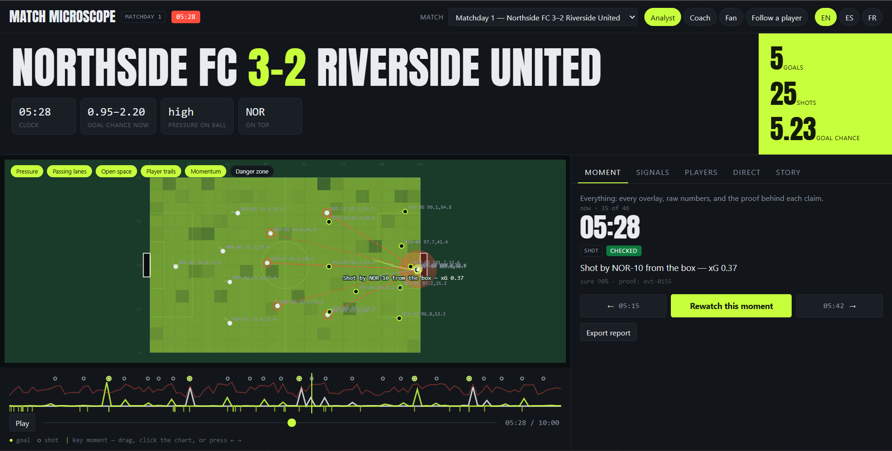
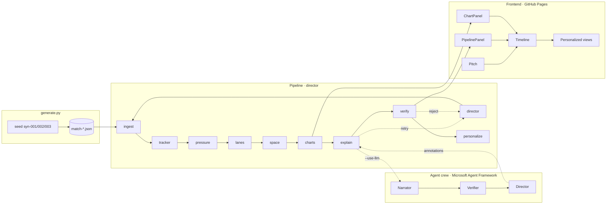
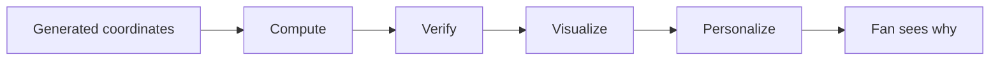
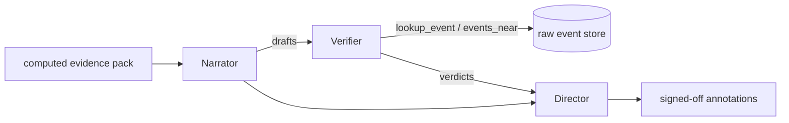

# Match Microscope



Match Microscope is a visual tactical replay tool for synthetic football match data "Google Maps for football." It turns raw player coordinates and event data into an interactive pitch with pressure bubbles, passing lanes, space heat maps and synced charts, so a viewer can scrub through a 10-minute match and understand *why* things happened. Every annotation is backed by raw event IDs and a verifier stamp, and the same intelligence is personalized to how you watch: analyst, coach, fan, or a single followed player, in English, Spanish or French.

## The five-stage mapping

| Stage | What it produces | Where it lives |
|---|---|---|
| **Ingest** | Parse synthetic frames + events, validate schema | `pipeline/jobs/ingest.py` |
| **Interpret** | Velocities + possession (`tracker`), pressure (`pressure`), lanes (`lanes`), space (`space`), networks/momentum/xG (`charts`) | `pipeline/jobs/tracker.py`, `pressure.py`, `lanes.py`, `space.py`, `charts.py` |
| **Explain** | Short pitch annotations with event-ID evidence — templates offline, or a real **Narrator → Verifier → Director** agent crew with Microsoft Agent Framework | `pipeline/jobs/explain.py`, `pipeline/agents/` |
| **Render** | Pitch overlays, heat maps, chart series | `src/components/Pitch.tsx`, `ChartPanel.tsx`, `Timeline.tsx` |
| **Personalize** | Role-based views, player-focus mode, multi-language | `pipeline/jobs/personalize.py` + `RoleSwitcher.tsx`, `PlayerCard.tsx`, `LanguageSwitcher.tsx` |

## Run it (two commands)

```bash
python pipeline/generate.py   # 3 matches -> public/data/ (~17s, numpy only)
pnpm install; pnpm dev        # app at http://localhost:3000
```

Pipeline (offline-friendly, templates by default):

```bash
python pipeline/run_pipeline.py                              # all matches, templates, no network
python pipeline/run_pipeline.py --match syn-001              # one match
python pipeline/run_pipeline.py --tui                        # live terminal dashboard (pip install textual)
python pipeline/run_pipeline.py --check my-match.json        # validate a file, writes nothing
python pipeline/run_pipeline.py --input my-match.json --id mine   # process your own match
python pipeline/run_pipeline.py --match syn-001 --use-llm    # real agent crew (needs a token)
```

Deploy: push to `main` — GitHub Actions builds the static export and publishes to Pages.

## Public demo

**Demo URL:** `https://BANKOLEDO.github.io/match-microscope/`

## Bring your own data

Two paths, both offline-first — use whichever suits you.

**In the terminal** — process any match file and regenerate the static site:

```bash
python pipeline/run_pipeline.py --check my-match.json              # validate only
python pipeline/run_pipeline.py --input my-match.json --id mine    # full pipeline
```

The pipeline reads the same shape it generates, writes `public/data/` artefacts and registers the match in `index.json`, so it shows up in the match switcher. Any fps, frame count, duration or squad size works; the only requirement is consistency — every frame must carry the same players and a ball, plus a valid `match` block.

**In the browser** — open Match Microscope and click **Analyze your own data** (or drag a JSON onto the page). The file is validated and a *lean preview* is computed locally: pitch, scoreboard, timeline, moments, possession, momentum, goal-chance race, pressure and the pass map. The heavy tactical jobs — passing lanes and open-space maps — are left out of the preview; run the CLI for those.

Interaction state is unchanged either way: the same overlays, roles and languages apply to your match.

Minimal file shape (`match.fps` and `match.duration` drive everything; player ids are `TEAM-NN` so the app can tell the two teams apart):

```json
{
  "match": {
    "id": "mine", "duration": 120, "fps": 2,
    "home": { "id": "HOM", "name": "Home" },
    "away": { "id": "AWY", "name": "Away" },
    "score": { "home": 1, "away": 1 }
  },
  "frames": [
    { "t": 0.0, "ball": { "x": 52, "y": 34, "z": 0, "owner": "HOM-09" },
      "players": [ { "id": "HOM-09", "x": 52, "y": 34 } ] }
  ],
  "events": [
    { "id": "e1", "t": 12.5, "type": "goal", "team": "HOM", "by": "HOM-09", "x": 100, "y": 34, "xg": 0.42 }
  ]
}
```

### Interactive terminal UI

`python pipeline/run_pipeline.py --tui` runs the pipeline in a live [Textual](https://textual.textualize.io/) dashboard: one row per job, a streaming trace, and retries highlighted as they happen. It needs `pip install textual` — optional, and not required for the CLI or the site.


## Technical architecture



## Conceptual flow



## Jobs

| Job | Role |
|---|---|
| `ingest` | Parse frames, normalize events, validate schema |
| `tracker` | Compute velocities, detect possession, distance covered |
| `pressure` | Pressure score on the ball carrier, per frame |
| `lanes` | Passing options with low/medium/high risk |
| `space` | Open-space heat map per 5-second window |
| `charts` | Pass network, momentum, xG race, pressure line |
| `explain` | Annotate each computed moment with event-ID evidence. Offline it renders `i18n.json` templates; with `--use-llm` it runs the **Narrator → Verifier → Director** Microsoft Agent Framework crew |
| `verify` | Reject any annotation whose evidence is missing or out of range |
| `personalize` | Role views, player index, language bundles |
| `director` | Orchestrate in order, retry `explain` up to 3 attempts, log handoffs, write `trace.json` |

Pipeline panel shows lowercase service rows with status, never personas:

```text
ingest       ● 3,000 frames          ok
tracker      ● 3,000 frames          ok
pressure     ● 3,000 scores          ok
lanes        ● 249 lane sets         ok
space        ● 120 heat maps         ok
charts       ● 4 series              ok
explain      ● 46 annotations        retry 1
verify       ● 45 verified, 1 failed ok
personalize  ● 4 modes × 3 langs     ok
director     ● trace written         ok
```

Two trust moments are **engineered deterministically** so every trace shows them without needing a real failure: `explain`'s first attempt is designed to fail and recover (hence `retry 1`), and `verify` deliberately rejects one annotation whose evidence id does not exist (`verified: false`). This is a reproducible demonstration of the retry and verification mechanisms, not a random bug or a claim that production inference failed.

When the agent crew is enabled this stops being a staged demo: the **Verifier agent** is handed a `lookup_event` tool wired to the raw event store, calls it for the cite-`evt-9999` claim, gets `NOT FOUND`, and rejects the annotation for real. The deterministic `verify` job still runs afterwards as an independent hard gate.

## The agent crew (Microsoft Agent Framework)

`--use-llm` upgrades the `explain` job from templates to a three-agent collaboration built on Microsoft Agent Framework's `Agent` and its provider-agnostic `OpenAIChatClient`:



- **Narrator** — writes one short broadcast line per moment (en/es/fr) using only the facts in its pack; never invents a player, score or stat.
- **Verifier** — a *tool-using* agent. It is handed `lookup_event` and `events_near`, which query the real raw event store, so it fact-checks every citation instead of trusting the draft. When it meets the cite-`evt-9999` claim its tool returns `NOT FOUND` and it rejects the annotation.
- **Director** — adjudicates the verdicts, keeps accepted narration and lowers confidence on anything questioned.
- **Fallback** — any agent or network error leaves the grounded templates standing; the deterministic `verify` job remains the final hard gate.

The backend is chosen by environment: **Microsoft Foundry / Azure OpenAI** when `AZURE_OPENAI_ENDPOINT` is set, or any **OpenAI-compatible** endpoint when `OPENAI_API_KEY` is set. Whichever ran is recorded as `agents` in every `trace-*.json` (see `describe_backend()` in `pipeline/agents/client.py`). Agent progress streams as `agent_start` / `agent_step` events, so the terminal UI shows the crew working live.

## Personalization

| Mode | Shows | Hides |
|---|---|---|
| **Analyst** | All overlays, raw coordinates, confidence scores, event IDs, xG inputs | — |
| **Coach** | Tactical layers (pressure, lanes, space), exportable report | Event IDs, coordinates |
| **Fan** | Momentum chart, danger zone, key moments only | All technical layers |
| **Player-focus** | One player highlighted + their involvement timeline; pass network around them | Other players dimmed |

**Multi-language:** annotation text in English, Spanish and French from the static `pipeline/i18n.json` dictionary — no live API calls, no cost. The switcher translates the *narrator*, not the UI chrome.

**Shareable:** role + language + focused player + timestamp live in the URL (`?match=syn-001&role=fan&lang=es&player=RIV-09&t=192`), so judges can pass personalized links around. No login, no accounts, no database.


## Design system

Broadcast tactical-desk aesthetic (StatsBomb / Opta breakdowns): full-bleed dark canvas, 65/35 pitch-to-data split, 48px header, bordered panels with dividers instead of shadows, mono tabular numerals for all data, one lime accent with red/yellow/green reserved for semantics, 120–200ms motion. Oversized display-type moments and floating stat chips borrow energy from a TENISTA-style sports-editorial reference, applied only to in-pitch annotation labels — the product itself stays a dense analysis desk, never a landing page. Tokens: [`src/styles/tokens.css`](src/styles/tokens.css).

## Hero technologies

- **Microsoft Agent Framework** — the orchestration model. The deterministic `director` implements the agentic pattern directly: ten specialized jobs, shared state, dependency ordering, retries, and a logged handoff per transition. An optional real crew (`pipeline/agents/`, Narrator → tool-using Verifier → Director) is implemented and can be switched on with `--use-llm`, but the shipped project runs **fully offline** on grounded templates.
- **A2A-style handoffs** — every job handoff is logged `{from, to, timestamp, payload_size, status}` into `trace-*.json`, rendered in the PIPELINE panel.
- **GitHub Copilot** — used during development.
- **Optional model backends (not used in the shipped build):** `pipeline/agents/client.py` is provider-agnostic — set `AZURE_OPENAI_*` (Microsoft Foundry / Azure OpenAI) or `OPENAI_API_KEY` to run the real crew. See [`.env.example`](.env.example) and `pip install -r pipeline/requirements-agents.txt`.
- **Production mapping (design only, not usage):** pipeline jobs map 1:1 to Azure Container Apps jobs, artefacts to Blob Storage + CDN.

## Zero-cost operation

- Data: generated locally by `python pipeline/generate.py` — stdlib + numpy, no network, no datasets, no Docker.
- Inference: templates by default — no network, no token. The optional Agent Framework crew (`--use-llm`) is off in the shipped build; when enabled it calls a model at **build** time only, with template fallback on any failure. Nothing calls an LLM at runtime in any configuration.
- Hosting: GitHub Pages (static export, `pnpm run build` → `out/`), GitHub Actions minutes on the free tier.
- Runtime: no backend, no database, no keys in the client. All intelligence is pre-computed into static JSON.
- Total: **$0**, no credit card.

## Category fit — Best Multi-Agent Orchestration

Match Microscope is a **purposeful multi-agent pipeline**, not a single model call. Ten specialized jobs — `ingest`, `tracker`, `pressure`, `lanes`, `space`, `charts`, `explain`, `verify`, `personalize`, and the `director` — have distinct roles and coordinate through shared state with a full `{from, to, timestamp, payload_size, status}` handoff trace rendered in the PIPELINE panel. The components demonstrably collaborate and recover: the `verify` job rejects the `explain` job's unsupported claim on record (`verified: false`), the `director` retries the failed inference path (`explain (retry 1)`), and `personalize` reshapes the verified output for four audiences and three languages. That is an end-to-end outcome no single agent produces on its own. An optional Microsoft Agent Framework crew (Narrator → tool-using Verifier → Director) is implemented in `pipeline/agents/` and can be enabled with `--use-llm`; the shipped build runs it offline on grounded templates. Secondary fit: **Best Enterprise Solution** (audit trail, role-based views, one-click report export) and **Best Use of Microsoft Foundry** (the provider-agnostic client routes the same crew to Foundry with one env-var change).

## Synthetic data

All matches are generated, football-realistic, and deterministic (seeded per match id). No real footage, no real data, no external downloads. Pitch 105×68, 5 fps, 10 minutes (3,000 frames), home 4-3-3 vs away 4-2-3-1, documented logistic xG model (see `pipeline/generate.py` header). Files stay under 400 KB gzipped each.

## Code of Conduct

This project follows the [Microsoft Open Source Code of Conduct](https://opensource.microsoft.com/codeofconduct/).
